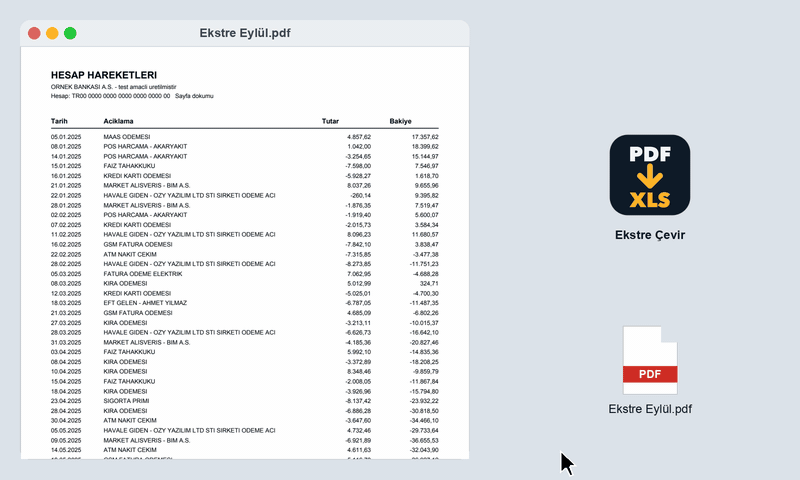

# Ekstre Çevir



PDF banka ekstresini ve PDF'teki tabloları Excel'e çeviren program. Ücretsiz, dosyanız bilgisayarınızdan çıkmıyor.

> Bu araç **Bunun Programı Var** kanalının 1. bölümünde sıfırdan yazıldı.
> Program sayfası: https://ozy2.com/programivar/ekstre-cevir/  ·  Kanal: https://youtube.com/@programivar

## İndir

En güncel sürüm: [Releases](../../releases/latest)

## Nasıl kullanılır

**macOS:** PDF'i **`Ekstre Çevir`** simgesinin üzerine sürükleyip bırak. Excel dosyası
PDF'in yanına kaydedilir ve açılır.

**Windows:** PDF'i **`Ekstre Cevir.bat`** dosyasının üzerine sürükleyip bırak.

İlk açılışta gerekli bileşenler bir kez kurulur (internet gerekir, ~15 sn). Sonraki açılışlar
bir saniyeden kısa sürer. Bilgisayarında Python 3.9 veya üstü olmalı.

**Komut satırı:** `./calistir.sh ekstre.pdf` ya da `python ekstre_cevir.py ekstre.pdf`

## Ne yapar

**Banka ekstresi** (`<ad>_ekstre.xlsx`)
- Tarih / açıklama / tutar / bakiye kolonlarını çıkarır
- Her tutarı **bakiyeyle doğrular**; uyuşmayan satırı atlamaz, `Kontrol` kolonunda işaretler
- Eksi işareti yazmayan (borç/alacak ayrı kolonlu) düzenlerde işareti bakiye farkından bulur
- İki satıra bölünmüş açıklamaları tek hücrede birleştirir

**Tablolu PDF** — ekstre değilse (`<ad>_tablo.xlsx`)
- Kenarlıklı ve kenarlıksız tabloları aktarır, her tablo ayrı sayfaya
- Birden çok sayfaya bölünmüş tabloyu tek tabloda birleştirir, tekrarlanan başlıkları atar
- Türk sayı biçimini (`1.234,56`, `1.250,00 TL`) toplanabilir sayıya çevirir; `0532…` gibi kodlar metin kalır

Belgenin ekstre olup olmadığına bakiye doğrulamasıyla karar verir: satırları tarihle başlayan
bir satış raporu ekstre sanılmaz.

## Ne yapmaz

- Taranmış (fotoğraf) PDF okumaz — PDF'in içinde seçilebilir yazı olmalı
- Tablolarda doğrulama yapmaz; özellikle **kenarlıksız** tablolarda kolonları gözle kontrol et
- Birleştirilmiş (birden çok kolona yayılan) hücreleri tek kolona koyar
- Ekstre okuyucu 3 farklı ekstre düzeninde test edildi; başka bir bankanın düzeninde `Kontrol` kolonuna bak

## Testler

```bash
python test/dogrula.py        # 3 ekstre düzeni, satır satır
python test/tablo_dogrula.py  # 5 tablo belgesi, hücre hücre
```

## Gizlilik

Bu program hiçbir veriyi internete göndermez. Dosyalarınız kendi bilgisayarınızda kalır;
program çalışırken internet bağlantısı gerekmez.

## Destek

Destek sözü vermiyorum. Kod açık — hata bulursan issue aç, düzeltirsen pull request gönder,
kendi ihtiyacına göre değiştirmek istersen çekinme.

## Lisans

MIT — bkz. [LICENSE](LICENSE)
